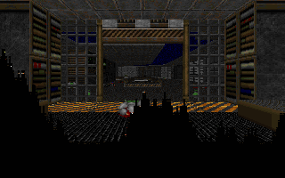

# qwendoom

**DOOM, running inside a language model.**



qwendoom compiles a RISC-V CPU into the weights of a stock Qwen3.5 checkpoint and runs DOOM's game
logic on it. Nobody trained this model: a compiler computed every weight. Monsters, doors,
bullets and your own footsteps are RV32 machine code that the model predicts one token at a time.
The host only draws the frames and types your keys in as tokens.

## Play

You need a macOS device, [uv](https://docs.astral.sh/uv/) and Homebrew's LLVM (the RISC-V
cross-compiler):

```bash
brew install llvm lld
uv sync --extra build
make            # fetches doomgeneric, Qwenputer and Freedoom
make weights    # compiles the CPU into a 5 GB Qwen3.5 checkpoint
uv run qwendoom serve --open
```

Press **Start**. W/S move, Q/E turn, A/D strafe, Ctrl or F fires, Space opens doors, Esc is the
menu. The arrow keys work too.

## How it works

- **The weights are the CPU.** 16 layers of Gated DeltaNet and MLP fetch, decode and execute
  RV32IM. The checkpoint has 2.57B parameters; 10.4M are not zero, and only 1.5M of those
  are the CPU (the rest is the embedding).
- **The state is the memory.** RAM, the level and DOOM's code live in the DeltaNet's recurrent
  state: a one-hot key writes a row, a one-hot query reads it back.
- **The output is the program running.** The model emits the CPU's execution trace, about 1.3
  tokens per instruction. One tick of DOOM (`P_Ticker`: monsters think, doors move, projectiles fly) is
  about 23,000 tokens.
- **The host is a screen and a keyboard.** It loads the level, renders from the RAM the model
  writes and feeds your keys in as tokens.
- **A sparse CPU engine runs the model.** It computes the exact bf16 forward pass and skips the
  zeros: about 30,000 tokens a second on one M5 Max core, so about a frame a second. The GPU loses
  here: one token is a chain of tiny kernels, and Metal's dispatch latency alone costs more than
  the CPU's whole step.

## Commands

```bash
uv run qwendoom serve            # the browser UI (--source native: the same DOOM, sim on the host)
uv run qwendoom run --gif out.gif --buttons 'forward@10-120,fire@60-64'
uv run qwendoom check --tics 400 # the model with the reference CPU in lockstep
uv run qwendoom bench            # tokens per second on real ticks
uv run qwendoom info             # the checkpoint
```

## Credits

Built on [Qwenputer](https://github.com/divagr18/qwenputer)'s compiler and RV32 core (MIT, see
[LICENSE.chipformer](LICENSE.chipformer)) and on
[nesformer](https://github.com/dbreunig/nesformer), which put an NES in the same model and lent its
engine and checkpoint code (MIT, see [LICENSE.nesformer](LICENSE.nesformer)).
